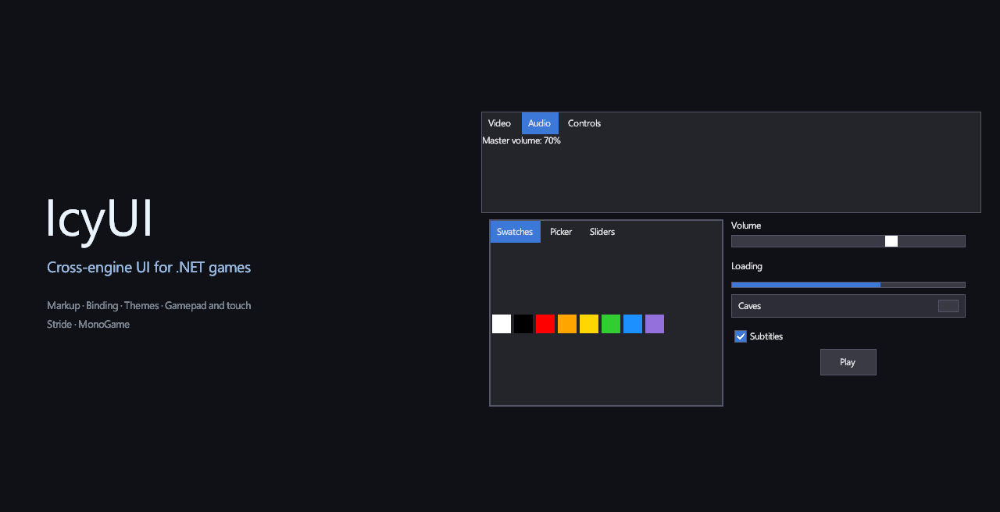
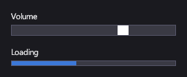

<p align="center">
  
</p>

<p align="center">
  <a href="https://github.com/IOExcept10n/IcyUI/actions/workflows/ci.yml"></a>
  <a href="https://www.nuget.org/packages/IcyUI.Stride"></a>
  <a href="https://www.nuget.org/packages/IcyUI.MonoGame"></a>
  
  <a href="LICENSE"></a>
  <a href="https://icyui.dev"></a>
</p>

# IcyUI

A cross-engine UI library for .NET games. The engine-agnostic core handles layout, controls, markup, styling, templating, data binding, input and animations. Thin integration packages connect it to a specific engine's rendering and input, so the screens you build don't depend on the engine underneath.

> **Status:** early alpha (`0.1.0-alpha`). Published on NuGet as prerelease packages; APIs may change between alphas.

**Documentation:** [icyui.dev](https://icyui.dev) · [на русском](https://icyui.dev/ru/)

## Why IcyUI

- **Write the screen once.** Describe it in XML markup with bindings, styles and templates, or build it in C#. The same screen runs on every supported engine.
- **Built for games.** Keyboard and gamepad navigation, touch gestures, drag-and-drop, DPI-aware scaling and an overlay layer for popups and dialogs are part of the core, not add-ons.
- **Looks right from the start.** A built-in default theme covers every control, and styles, visual states and control templates let you replace it piece by piece.
- **Fast iteration.** An in-game editor and markup hot reload (`IcyUI.Design`) let you change a screen while the game runs.
- **Small engine footprint.** The core never references an engine type. Each integration is a thin connector, so supporting another engine is a bounded job.

## Quick start

Requires the .NET 10 SDK. Add the package for your engine:

```
dotnet add package IcyUI.Stride --prerelease
dotnet add package IcyUI.MonoGame --prerelease
```

Describe a screen in markup (`Menu.xml`):

```xml
<StackPanel HorizontalAlignment="Center" VerticalAlignment="Center" Orientation="Vertical">
  <TextBlock FontSize="32" Margin="0,0,0,24" HorizontalAlignment="Center" Text="{Binding Path=Title}" />
  <Button Padding="24,8" Margin="0,0,0,8" Command="{Binding Path=PlayCommand}">Play</Button>
  <Button Padding="24,8" Command="{Binding Path=QuitCommand}">Quit</Button>
</StackPanel>
```

Then load it in your game. In a MonoGame `Game`:

```csharp
this.UseIcyUI().MainCanvas.LoadMarkup("Menu.xml", new MenuViewModel());
```

In Stride, call `Game.UseIcyUI()` from a startup script instead. The setup for each engine, and the `MenuViewModel` that the bindings read, are in [Getting started](https://icyui.dev/getting-started/installation.html).

## Controls

<table>
  <tr>
    <td align="center"><a href="https://icyui.dev/controls/range.html"></a><br><sub>Sliders and progress</sub></td>
    <td align="center"><a href="https://icyui.dev/controls/lists.html"></a><br><sub>Lists and drop-downs</sub></td>
    <td align="center"><a href="https://icyui.dev/controls/tree-view.html"></a><br><sub>Trees</sub></td>
  </tr>
  <tr>
    <td align="center"><a href="https://icyui.dev/controls/navigation.html"></a><br><sub>Tabs and navigation</sub></td>
    <td align="center"><a href="https://icyui.dev/controls/editors.html"></a><br><sub>Color picker and property grid</sub></td>
    <td align="center"><a href="https://icyui.dev/controls/dialogs.html"></a><br><sub>Windows and dialogs</sub></td>
  </tr>
</table>

Also: `Button`, `ToggleButton`, `CheckBox`, `TextBox`, `Expander`, `SplitPane`, `ScrollViewer` (with virtualization), and the `Grid`, `StackPanel` and `WrapGrid` panels. See the [controls reference](https://icyui.dev/controls/index.html).

## Engines

| Package | Status |
|---|---|
| `IcyUI.Stride` | Integration for Stride 4.4+ |
| `IcyUI.MonoGame` | Integration for MonoGame 3.8.5.1+, backend-neutral (DesktopGL or WindowsDX) |
| `IcyUI.FNA` | Planned |

## Where to go next

- [Getting started](https://icyui.dev/getting-started/installation.html): installation and your first screen.
- [Guides](https://icyui.dev/guides/index.html): a game menu, gamepad navigation, custom controls and themes, localization, hot reload and the editor, writing an engine integration.
- [API reference](https://icyui.dev/api/index.html).
- Samples: sample hosts for both engines live in `sources/MonoGame Sample` and `sources/Stride Sample`. Their demos are shared from `sources/Shared Samples`.

## Building from source

Requires the .NET 10 SDK.

```
dotnet build sources/IcyUI.sln
dotnet test sources/IcyUI.Tests/IcyUI.Tests.csproj
```

The documentation site is built from `docfx/` (see `CLAUDE.md`).

## History

The project started as MysticUI, a Stride UI library based on [Myra](https://github.com/rds1983/Myra), and was later renamed AquaUI. It has since been rewritten as IcyUI.

## License

[MIT](LICENSE)
