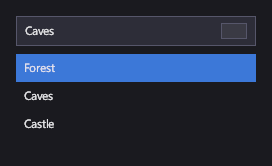

# Lists and selection

These controls show a collection of items from your view model. A <xref:Icy.UI.Controls.ListBox> shows them all and
lets the player select one; a <xref:Icy.UI.Controls.ComboBox> and a <xref:Icy.UI.Controls.Dropdown> show the selected
item and open a list on demand. An <xref:Icy.UI.Controls.ItemsControl> just shows items, and a
<xref:Icy.UI.Controls.WrapGrid> lays them out in a grid of equal cells, like an inventory.

## Markup

[!code-xml]

`ItemsSource` comes from the data context (here, a list of level names). `SelectedIndex` can be set before the items
arrive: it's applied as soon as they do.

## Key properties

| Property | Description |
|---|---|
| <xref:Icy.UI.Controls.ItemsControl.ItemsSource> | The items to show. Use an `ObservableCollection<T>` to have additions and removals appear. |
| <xref:Icy.UI.Controls.ItemsControl.ItemTemplate> | How each item looks. Without one, an item shows its `ToString()`. |
| <xref:Icy.UI.Controls.SelectingItemsControl.SelectedIndex> / <xref:Icy.UI.Controls.SelectingItemsControl.SelectedItem> | The selection; `-1` / `null` for none. |
| <xref:Icy.UI.Controls.Selector.DisplayMemberPath> | For a combo box or dropdown, the item property to show. |
| <xref:Icy.UI.Controls.Selector.IsOpen> | Whether a combo box's or dropdown's list is open. |
| <xref:Icy.UI.Controls.WrapGrid.ItemWidth> / <xref:Icy.UI.Controls.WrapGrid.ItemHeight> | A wrap grid's cell size. |

## Events and commands

<xref:Icy.UI.Controls.SelectingItemsControl.SelectionChanged> fires when the selection changes. Binding
`SelectedItem` two-way is usually simpler.

## Styling

Each item sits in a `SelectorItem` with the visual states `Hovered`, `Selected`, `SelectedHovered`, `Highlighted`,
`HighlightedHovered` and `Disabled`. A combo box and a dropdown use `Hovered` and `Focused`.

Items are virtualized: only the ones in view get a container, and containers are reused as the list scrolls, so an
item template mustn't keep state of its own that doesn't come from its item.

## Keyboard, gamepad and touch

A click or tap selects an item. On a focused combo box or dropdown, Enter or the gamepad's A button opens the list,
the arrow keys and the D-pad move the highlight, and Enter or A commits it. Escape or B closes the list. A combo box
also filters its list as the player types.

> [!NOTE]
> A list box's items can't be selected with the keyboard or a gamepad yet; only by clicking or tapping.

## ListBox

Shows its items in a column. Inside a [ScrollViewer](scrolling.md), it scrolls; on its own, it shows the items that
fit its height.

## ComboBox

An editable box: the player can type to filter the list.

## Dropdown

Like a combo box, without the text entry.

## ItemsControl

The base of all these: items and a template, no selection.

## WrapGrid

Fills rows of equal cells and wraps, for inventories and level grids.

## See also

- [Scrolling](scrolling.md) for long lists.
- [Data binding](../markup/index.md#markup-extensions) in the markup reference.
