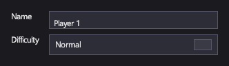

# Panels

Panels arrange other elements. A <xref:Icy.UI.Controls.StackPanel> places its children one after another, in a column
or a row. A <xref:Icy.UI.Controls.Grid> places them in rows and columns, which suits forms and HUD layouts.

## Markup

[!code-xml]

`Grid.Row` and `Grid.Column` are attached properties: each child says which cell it sits in.

## Key properties

| Property | Description |
|---|---|
| <xref:Icy.UI.Controls.StackPanel.Orientation> | `Vertical` (a column) or `Horizontal` (a row). |
| <xref:Icy.UI.Controls.Grid.ColumnDefinitions> / <xref:Icy.UI.Controls.Grid.RowDefinitions> | The columns and rows, each with a size. |

A column `Width` or row `Height` is one of:

- `Auto`: as big as its content;
- a number: that many pixels;
- `*`: a share of the space left over. `2*` gets twice the share of `*`.

## Events and commands

Panels raise none of their own.

## Styling

Panels draw nothing themselves unless you give them a `Background`. Use `Margin` on children for spacing.

## Keyboard, gamepad and touch

Panels don't take focus. The arrow keys and the D-pad move focus between the controls inside, to the nearest one in
the pressed direction.

## StackPanel

Children keep their own size along the stacking direction and, by default, stretch across it (a button in a column
stays centered: buttons size to their content).

## Grid

A child can span several cells with `Grid.RowSpan` and `Grid.ColumnSpan`.

## See also

- [Scrolling](scrolling.md) for content larger than its panel.
