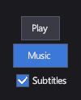

# Кнопки

<xref:Icy.UI.Controls.Button> выполняет действие, когда игрок щёлкает или касается её либо активирует её с клавиатуры
или геймпада. <xref:Icy.UI.Controls.ToggleButton> и <xref:Icy.UI.Controls.CheckBox> к тому же хранят состояние «вкл./выкл.»:
кнопка-переключатель подходит для режима, который игрок переключает (музыка вкл. или выкл.), а флажок — для пункта в
списке настроек.

## Разметка

[!code-xml]

Текст внутри кнопки становится её содержимым: строка показывается в <xref:Icy.UI.Controls.TextBlock>. Содержимым может
быть и любой элемент, например значок с подписью в `StackPanel`.

## Основные свойства

| Свойство | Описание |
|---|---|
| <xref:Icy.UI.Controls.Button.Command> | Команда, которую выполняет кнопка. Привяжите её к команде модели представления. |
| <xref:Icy.UI.Controls.ContentControl.Content> | Что показывает кнопка: текст или любой элемент. |
| <xref:Icy.UI.Controls.ToggleButton.IsChecked> | Включена ли кнопка-переключатель или флажок. |
| <xref:Icy.UI.Controls.CheckBox.CheckBrush> | Цвет галочки флажка. |

## События и команды

При активации кнопка вызывает событие <xref:Icy.UI.Controls.Button.Click> и выполняет свою
<xref:Icy.UI.Controls.Button.Command>. Кнопка-переключатель и флажок переключают
<xref:Icy.UI.Controls.ToggleButton.IsChecked> и вызывают <xref:Icy.UI.Controls.ToggleButton.IsCheckedChanged>.

## Стиль

В теме по умолчанию кнопки тёмно-серые со светлым текстом; они принимают размер содержимого и располагаются по центру
отведённого им места. Задайте кнопке `HorizontalAlignment="Stretch"` (или `VerticalAlignment`), чтобы она заполнила своё
место, например в колонке меню.

Стили темы используют такие группы визуальных состояний. Ваша группа с тем же именем заменяет группу темы (см.
[Шаблоны и визуальные состояния](../concepts/templates-and-visual-states.md)):

| Элемент | `CommonStates` | `FocusStates` | `CheckStates` |
|---|---|---|---|
| `Button` | `Hovered`, `Pressed` | `Focused` | |
| `ToggleButton` | `Hovered`, `Pressed` | `Focused` | `Checked` |
| `CheckBox` | `Hovered` | `Focused` | `Checked` |

См. раздел [Ресурсы и стили](../markup/index.md#ресурсы-и-стили) справочника по разметке.

## Клавиатура, геймпад и сенсорный ввод

Кнопка в фокусе выполняет свою команду по Enter или кнопке A геймпада; кнопка-переключатель или флажок переключают
состояние. Стрелки и крестовина геймпада перемещают фокус между элементами. Касание выполняет команду, как щелчок.

## ToggleButton

Выглядит как кнопка и остаётся подсвеченной, пока включена (состояние `Checked`).

## CheckBox

Квадрат с галочкой рядом с содержимым. Используйте его в списках настроек, а кнопку-переключатель — для режима на панели
инструментов или в HUD.

## См. также

- [Текст](text.md) — о тексте внутри кнопок.
- [Панели](panels.md) — как выстроить кнопки в меню.
