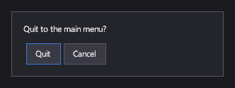

# Диалоги и окна

<xref:Icy.UI.Controls.Window> — панель в рамке, которая, пока открыта, удерживает фокус клавиатуры и геймпада внутри
себя: для внутриигрового меню или инвентаря. <xref:Icy.UI.Controls.Dialog> модален: он закрывает экран затемнённым фоном,
не пропускает к элементам за собой мышь и касания и закрывается по Escape или кнопке B геймпада.
<xref:Icy.UI.Controls.MessageBox> показывает готовый диалог с сообщением и кнопками и возвращает ответ игрока.

## Разметка

[!code-xml]

Окно добавляется на Canvas как любой элемент и рисуется только в открытом состоянии: вызовите `Show()`, чтобы открыть
его, и `Close()`, чтобы закрыть.

Для вопроса со стандартными ответами используйте окно сообщения из кода:

[!code-csharp]

## Основные свойства

| Свойство | Описание |
|---|---|
| <xref:Icy.UI.Controls.Window.IsOpen> | Открыто ли окно. |
| <xref:Icy.UI.Controls.ContentControl.Content> | Что показывает окно или диалог. |

## События и команды

<xref:Icy.UI.Controls.Window.Opened> и <xref:Icy.UI.Controls.Window.Closed> у окна, <xref:Icy.UI.Controls.Dialog.Closed>
у диалога. <xref:Icy.UI.Controls.Dialog%601> добавляет результат: его `ShowAsync` возвращает задачу, которая завершается
значением, с которым закрылся диалог.

## Стиль

Тема по умолчанию даёт окнам тёмный фон и рамку. Шаблон диалога рисует затемнённый фон и размещает окно содержимого по
центру.

## Клавиатура, геймпад и сенсорный ввод

Пока окно или диалог открыты, Tab, стрелки и крестовина перемещают фокус только между их элементами, а после закрытия
фокус возвращается туда, где был. Escape или B закрывают диалог или окно сообщения (окно сообщения тогда возвращает
`DialogResult.None`).

> [!NOTE]
> Окно не перехватывает мышь и касания: элементы за ним остаются доступными. Используйте диалог, если до ответа игрока
> больше ничем пользоваться нельзя.

## Window

Не модально для указателя, модально для фокуса.

## Dialog

Показывается вызовом `Show(canvas)` как оверлей поверх всего на Canvas.

## MessageBox

`ShowAsync(canvas, message, buttons)` с `DialogButtons.OK`, `OKCancel`, `YesNo` или `YesNoCancel`, а также
`ShowInputAsync(canvas, prompt)` для строки текста.

Подписи кнопок локализуются: ключи `OK`, `Cancel`, `Yes` и `No` в контексте `Icy.MessageBox` (`msgctxt` в файле
`.po`). Без перевода они показываются по-английски. Свои подписи, например «Выйти» вместо «OK», передайте в
`ShowAsync(canvas, message, buttons, result => ...)`. См. [Локализация](../concepts/localization.md).

## См. также

- [Кнопки](buttons.md) — для действий диалога.
