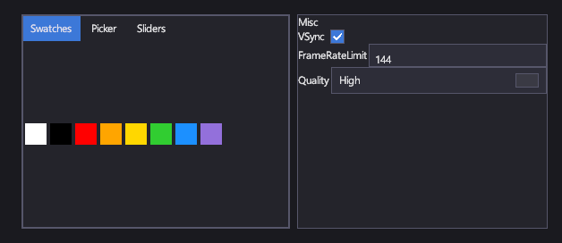

# Редакторы цвета и свойств

<xref:Icy.UI.Controls.ColorPicker> позволяет игроку выбрать цвет: из образцов, на поле тона и насыщенности или
ползунками и шестнадцатеричным кодом. <xref:Icy.UI.Controls.ColorPickerButton> — компактная кнопка, показывающая цвет и
открывающая палитру во всплывающем окне. <xref:Icy.UI.Controls.PropertyGrid> редактирует открытые свойства любого
объекта — это подходит для отладочных панелей и редакторов уровней.

## Разметка

[!code-xml]

`Target` таблицы свойств — объект со свойствами `VSync` (`bool`), `FrameRateLimit` (`int`) и `Quality` (перечисление).

## Основные свойства

| Свойство | Описание |
|---|---|
| <xref:Icy.UI.Controls.ColorPicker.SelectedColor> | Выбранный цвет. |
| <xref:Icy.UI.Controls.ColorPicker.SwatchColors> | Образцы на вкладке Swatches. Изначально это восемь распространённых цветов; после изменения вызовите `RefreshSwatches()`. |
| <xref:Icy.UI.Controls.ColorPickerButton.SelectedColor> | Цвет кнопки, общий с её всплывающей палитрой. |
| <xref:Icy.UI.Controls.PropertyGrid.Target> | Объект, свойства которого редактирует таблица. |

## События и команды

<xref:Icy.UI.Controls.ColorPicker.ColorChanged> срабатывает при смене цвета. Таблица свойств записывает каждое изменение
прямо в свойство объекта.

## Стиль

Стили темы задают фон и рамку всем трём элементам; их части создаются в коде и не имеют именованных частей шаблона.

## Клавиатура, геймпад и сенсорный ввод

Вкладки, образцы и ползунки палитры реагируют на щелчки и касания. Редакторы в таблице свойств — обычные текстовые поля,
флажки, поля со списком и ползунки, поэтому работают так, как описано на страницах этих элементов.

## ColorPicker

Задавайте ему размер явно (например, 300 × 240): вкладкам нужно место.

## ColorPickerButton

Показывает образец своего цвета; щелчок открывает палитру под кнопкой или над ней, если снизу нет места.

## PropertyGrid

Выбирает редактор по типу каждого свойства:

- `string`: текстовое поле;
- `bool`: флажок;
- числа: текстовое поле или, если у свойства есть атрибут `[Range]`, ползунок с текстовым полем;
- перечисления: поле со списком значений перечисления;
- `Color`: кнопка палитры цветов.

Свойства группируются по своему `[Category]`, а без него — в группу «Misc». Свойства только для чтения показывают значение,
но не редактируются.

## См. также

- [Текст](text.md) и [Элементы диапазона](range.md) — редакторы, которые использует таблица свойств.
