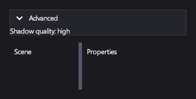

# Expander и SplitPane

<xref:Icy.UI.Controls.Expander> показывает или скрывает своё содержимое под заголовком — для необязательных
подробностей вроде расширенных настроек. <xref:Icy.UI.Controls.SplitPane> делит своё место между двумя панелями с
разделителем, который игрок перетаскивает, как в раскладке редактора.

## Разметка

[!code-xml]

Содержимое `Expander` — его дочерний элемент. Две панели `SplitPane` — это элементы свойств `SplitPane.First` и
`SplitPane.Second`.

## Основные свойства

| Свойство | Описание |
|---|---|
| <xref:Icy.UI.Controls.Expander.Header> | Заголовок: текст или любой элемент. |
| <xref:Icy.UI.Controls.Expander.IsExpanded> | Показано ли содержимое. |
| <xref:Icy.UI.Controls.SplitPane.First> / <xref:Icy.UI.Controls.SplitPane.Second> | Две панели. |
| <xref:Icy.UI.Controls.SplitPane.Orientation> | `Horizontal` ставит панели рядом, `Vertical` — одну над другой. |
| <xref:Icy.UI.Controls.SplitPane.SplitterPosition> | Положение разделителя, от 0 до 1. |
| <xref:Icy.UI.Controls.SplitPane.MinFirstSize> / <xref:Icy.UI.Controls.SplitPane.MinSecondSize> | Насколько маленькой может стать каждая панель. |

## События и команды

<xref:Icy.UI.Controls.Expander.IsExpandedChanged> и <xref:Icy.UI.Controls.SplitPane.SplitterPositionChanged>.

## Стиль

В шаблоне `Expander` есть часть заголовка `PART_Header` (`ExpanderHeader`) с визуальными состояниями `Hovered`,
`Pressed`, `Focused` и `Checked` (шеврон поворачивается). `Expander` анимирует переход между состояниями `Expanded` и
`Collapsed` за 0,2 секунды. Разделитель `SplitPane` — часть `PART_Divider` с состояниями `Hovered` и `Pressed`.

## Клавиатура, геймпад и сенсорный ввод

Заголовок `Expander` — это кнопка-переключатель: Enter или кнопка A геймпада раскрывают или сворачивают его, как и
щелчок или касание. Разделитель `SplitPane` следует за мышью или пальцем при перетаскивании.

## Expander

В свёрнутом виде занимает только высоту заголовка.

## SplitPane

Панели меняют размер вслед за разделителем; каждая не становится меньше своего минимального размера.

## См. также

- [Панели](panels.md) — для неизменной компоновки.
