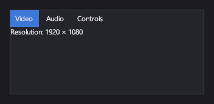

# Вкладки и навигация

<xref:Icy.UI.Controls.TabControl> показывает одну страницу за раз под рядом вкладок, например разделы экрана настроек.
<xref:Icy.UI.Controls.Frame> показывает одну <xref:Icy.UI.Controls.Page> за раз и переходит между страницами с историей
«назад» и «вперёд» — для целых экранов меню.

## Разметка

[!code-xml]

Вкладки берутся из `ItemsSource`: это список <xref:Icy.UI.Controls.TabItem>, у каждого заголовок и страница. Здесь их
предоставляет модель представления:

[!code-csharp]

## Основные свойства

| Свойство | Описание |
|---|---|
| <xref:Icy.UI.Controls.ItemsControl.ItemsSource> | Элементы `TabItem`. |
| <xref:Icy.UI.Controls.SelectingItemsControl.SelectedIndex> | Открытая вкладка. |
| <xref:Icy.UI.Controls.TabItem.Header> / <xref:Icy.UI.Controls.TabItem.Icon> | Подпись и значок вкладки. |
| <xref:Icy.UI.Controls.ContentControl.Content> | Страница вкладки (у `TabItem`). |
| <xref:Icy.UI.Controls.Frame.Navigation> | Навигация фрейма: текущая страница и её история. |

## События и команды

<xref:Icy.UI.Controls.SelectingItemsControl.SelectionChanged> срабатывает при смене открытой вкладки.

## Стиль

Заголовки вкладок — это `SelectorItem` со стилем элементов списка (`Hovered`, `Selected`, ...). Стиль самого элемента с
вкладками задаёт его фон и рамку.

## Клавиатура, геймпад и сенсорный ввод

Щелчок или касание вкладки открывает её.

> [!NOTE]
> Вкладки пока нельзя переключать с клавиатуры или геймпада.

## TabControl

В компоновке участвует только страница открытой вкладки.

## Frame и Page

Фрейм переходит между страницами, описанными в разметке; см. раздел
[Страницы и навигация](../markup/index.md#страницы-и-навигация) справочника по разметке.

## См. также

- [Списки и выбор](lists.md): элемент с вкладками — это список вкладок с выделением.
