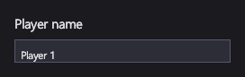

# Текст

<xref:Icy.UI.Controls.TextBlock> показывает текст: подписи, заголовки, надписи. <xref:Icy.UI.Controls.TextBox> позволяет
игроку ввести одну строку текста, например имя или сид.

## Разметка

[!code-xml]

`Text` текстового поля по умолчанию привязывается в обе стороны, поэтому то, что вводит игрок, попадает обратно в
свойство `PlayerName` модели представления; `Mode=TwoWay` в примере написан только для наглядности.

## Основные свойства

| Свойство | Описание |
|---|---|
| <xref:Icy.UI.Controls.TextBlock.Text> / <xref:Icy.UI.Controls.TextBox.Text> | Показываемый или редактируемый текст. |
| <xref:Icy.UI.Controls.TextBlock.FontFamily> | Имя семейства шрифтов. Без него используется семейство по умолчанию из конфигурации (Segoe UI с настройками движков по умолчанию). |
| <xref:Icy.UI.Controls.TextBlock.FontSize> | Размер в пикселях. |
| <xref:Icy.UI.Controls.TextBlock.FontStyle> | Обычный, полужирный, курсив. |
| <xref:Icy.UI.Controls.TextBlock.TextWrapping> | `Wrap` разбивает текст `TextBlock` на строки по его ширине. |
| <xref:Icy.UI.Controls.TextBlock.TextAlignment> | `Left`, `Center` или `Right`: где стоит каждая строка `TextBlock`. |
| <xref:Icy.UI.UIElement.Foreground> | Цвет текста. Тема по умолчанию делает его светлым. |

Свойства шрифта не наследуются: задайте их каждому текстовому элементу или сразу всем — неявным `Style`.

## События и команды

<xref:Icy.UI.Controls.TextBox.TextChanged> срабатывает при каждом изменении. С привязкой оно обычно не нужно: вместо
этого меняется привязанное свойство.

Если текстовое поле двусторонне привязано к числу, а игрок вводит что-то, что числом не является, привязка сохраняет
прежнее значение, а поле показывает состояние `Invalid` (красная рамка в теме по умолчанию), пока текст снова не станет
числом.

## Стиль

Тема по умолчанию делает текст `TextBlock` светлым, а `TextBox` даёт тёмный фон и рамку. Визуальные состояния текстового
поля — `Focused`, `Invalid` и `FocusedInvalid`.

Если шрифт не найден, текст рисуется резервным шрифтом конфигурации, а IcyUI один раз пишет предупреждение об этом
семействе в журнал. См. [Шрифты на других платформах](../getting-started/stride.md#шрифты-на-других-платформах).

## Клавиатура, геймпад и сенсорный ввод

Текстовое поле в фокусе принимает вводимый текст. Стрелки влево и вправо двигают курсор ввода, Home и End переносят его
в начало и конец, Backspace и Delete удаляют символы. На краях текста стрелки влево и вправо, как всегда стрелки вверх и
вниз, переводят фокус к соседнему элементу, поэтому с геймпада из поля можно выйти крестовиной. При вводе за правый край
текст прокручивается, чтобы курсор оставался видимым.

> [!NOTE]
> Выделение текста (Shift+стрелки, перетаскивание) и буфер обмена пока не поддерживаются.

## TextBlock

Подстраивается под свой текст: одна строка высотой с межстрочное расстояние шрифта, поэтому буквы вроде y и g не
обрезаются.

С `TextWrapping="Wrap"` текст переносится на новую строку по пробелам, а внутри слова — если слово шире всей строки.
Ширина строки — собственная `Width` элемента, а без неё — ширина, которую ему даёт панель, но не больше `MaxWidth`;
высота растёт по числу строк. Для карточки фиксированной ширины:
`<TextBlock Width="240" TextWrapping="Wrap" TextAlignment="Center" Text="{Binding Description}"/>`.

В ячейке, которая подстраивается под содержимое, например в столбце сетки `Auto`, переносить не по чему: задайте там
`Width` или `MaxWidth`.

## TextBox

Однострочное поле. Подстраивается под текст; задайте `Width`, чтобы поле было фиксированной ширины.

## См. также

- [Шрифты на других платформах](../getting-started/stride.md#шрифты-на-других-платформах).
- [Панели](panels.md) — как выровнять подписи и поля ввода.
