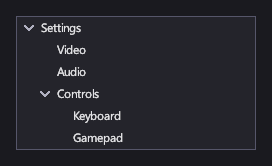

# Дерево

<xref:Icy.UI.Controls.TreeView> показывает вложенные элементы, которые игрок раскрывает и сворачивает: дерево настроек,
журнал заданий, иерархию сцены в редакторе уровней.

## Разметка

[!code-xml]

Статичное дерево записывается в разметке элементами <xref:Icy.UI.Controls.TreeViewNode>: у каждого узла есть `Header`,
дочерние узлы и `IsExpanded`/`IsSelectable`. Чтобы построить дерево из своих данных, привяжите
<xref:Icy.UI.Controls.TreeView.ItemsSource> к корневым элементам и задайте в <xref:Icy.UI.Controls.TreeView.ChildrenSelector>
функцию, возвращающую дочерние элементы.

## Основные свойства

| Свойство | Описание |
|---|---|
| <xref:Icy.UI.Controls.TreeView.Items> | Корневые узлы, записанные в разметке. |
| <xref:Icy.UI.Controls.TreeView.ItemsSource> / <xref:Icy.UI.Controls.TreeView.ChildrenSelector> | Дерево из ваших данных. |
| <xref:Icy.UI.Controls.TreeView.SelectedItem> | Выбранный элемент. |
| <xref:Icy.UI.Controls.TreeView.Indent> | Отступ каждого уровня. |

## События и команды

<xref:Icy.UI.Controls.TreeView.SelectionChanged>, <xref:Icy.UI.Controls.TreeView.ItemExpanded> и
<xref:Icy.UI.Controls.TreeView.ItemCollapsed>.

## Стиль

Каждая строка — `TreeViewItem`, в шаблоне которого есть части `PART_Indent` и `PART_Expander` (шеврон). Его визуальные
состояния — `Hovered`, `Selected`, `SelectedHovered`, `Highlighted`, `HighlightedHovered`, `SelectedHighlighted` и
`Disabled`.

## Клавиатура, геймпад и сенсорный ввод

Стрелки вверх и вниз (или крестовина) переходят между строками. Стрелка вправо раскрывает строку или, если она уже
раскрыта, переходит внутрь; стрелка влево сворачивает её или переходит к родителю. Enter или кнопка A геймпада
переключают строку с дочерними элементами. Щелчок или касание шеврона раскрывает или сворачивает строку, а щелчок по
самой строке выбирает её.

## См. также

- [Списки и выбор](lists.md) — для плоских списков.
